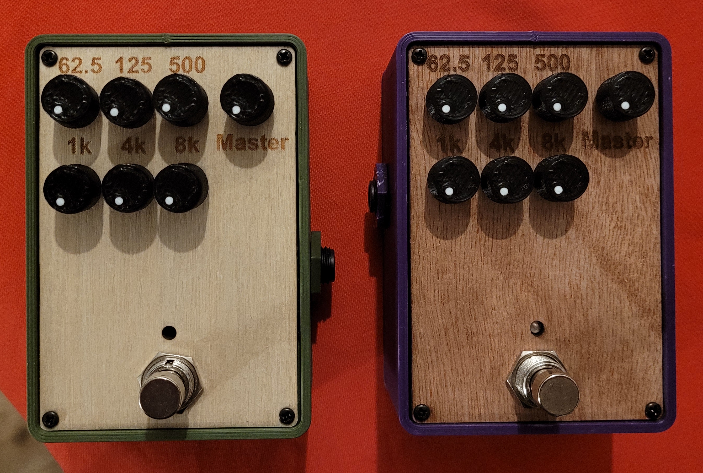
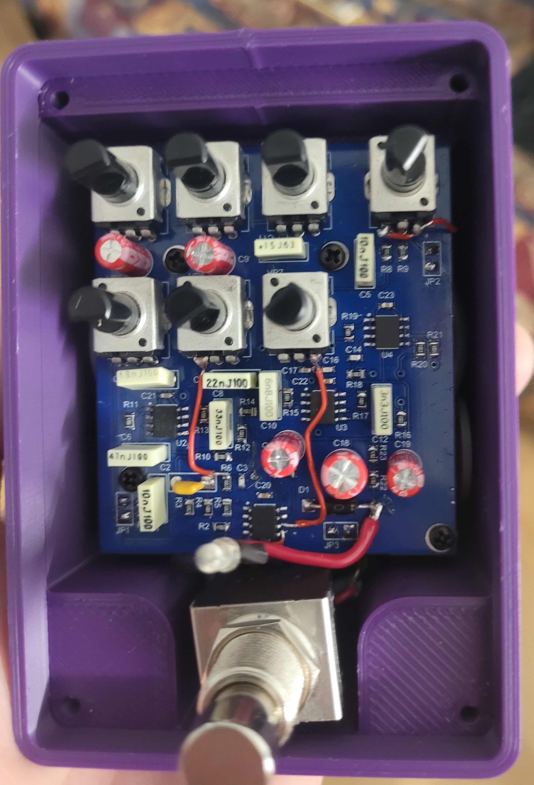
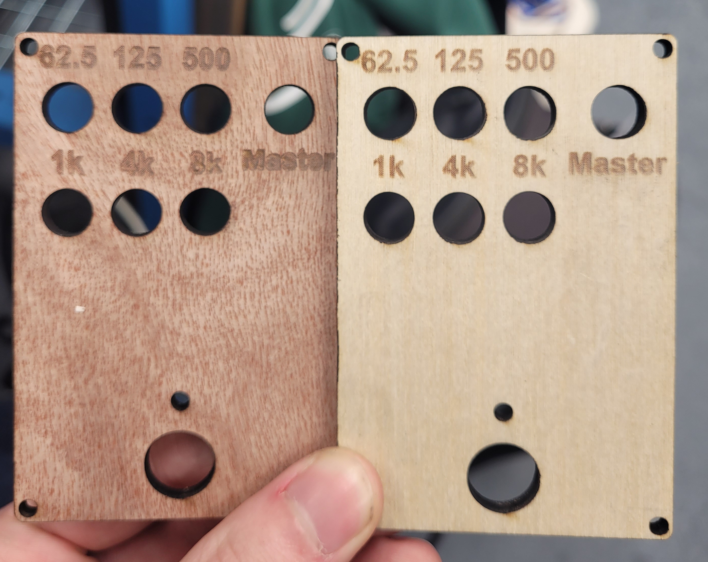

# Analog 6-Band Graphic Equalizer (EQ) Guitar Pedal



An analog audio engineering project featuring a custom-designed 6-band graphic equalizer pedal for electric guitars. This repository hosts the original hardware schematics, PCB layout designs, and mechanical enclosure files.

---

## Important Engineering Note & Errata (Rev A)

**Project Status:** *Archived / Legacy.* This project serves as a proof-of-concept for analog audio filtering. It will not receive future hardware revisions as project requirements evolved following its completion. A next-generation EQ pedal project will be published soon to succeed this design.

### Known Hardware Bug (Potentiometer Footprint Pinout)
* **The Issue:** In this initial Rev A PCB layout, the outer pins (Pin 1 and Pin 3) of the potentiometer footprints were accidentally swapped. As a result, turning the control knobs counter-clockwise increases the filtering amplitude/volume instead of decreasing it.
* **The Fix:** For the physical prototype boards, this layout discrepancy was successfully resolved using standard **wire-wrap rework (bodge wires)** directly on the PCB to correctly re-route the signal flows.
* *Note for builders: If you intend to manufacture this specific layout, you must manually cross the outer potentiometer pins or adjust your wiring harness accordingly.*



---

## Hardware Engineering

### 1. Circuit Design & PCB Layout (`/hardware`)
Designed and routed using **Altium Designer**. The circuit focuses on maintaining high signal fidelity and low noise floors for high-impedance instrument inputs.
* **Analog Filtering Network:** Implemented active operational amplifier (Op-Amp) filter topologies to achieve dedicated 6-band frequency equalization controls.
* **Form Factor:** Engineered as a compact, single-board layout optimized to match the standard footprint of a classic Boss effects pedal.
* **Power Management:** Includes input filtering and decoupling networks to clear up switching noise introduced by standard 9V DC pedalboard power supplies.

### 2. Enclosure & Mechanical Design (`/3d_models`)
* Modeled a custom functional enclosure using **Autodesk Fusion 360** to protect the internal circuitry, integrating 3D STEP models of the PCB and mechanical footswitch for clearance verification.
* Features a custom **laser-cut wooden faceplate** with precision-engraved parameter text.



---

## Repository Directory Structure

```text
├── 3d_models/          # Fusion 360 (.f3z) source designs, along with PCB and footswitch STEP models
├── docs/               # Visual documentation and photos tracking the project's build progress
├── hardware/           # Altium Designer project structures, schematics, and manufacturing Gerber files
└── README.md           # This file
```

---

## Contributors & Credits
* **Alexandre Dionne** – Sole Hardware Engineer (Complete PCB design, component assembly, hardware debugging/rework, 3D-printed enclosure design, and laser-cutter CAM prototyping).
